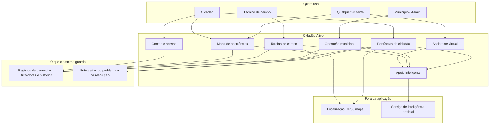
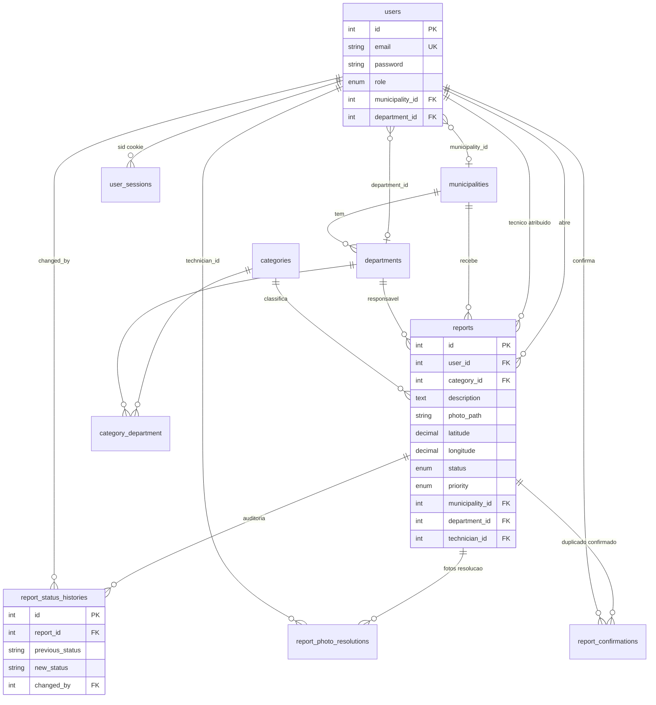
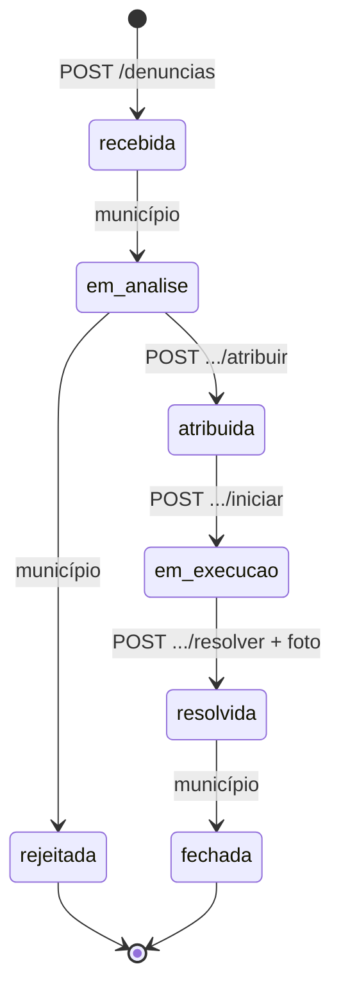

# Cidadão Ativo — versão Node.js + Express + MySQL

Plataforma de reporte urbano para Maputo: **Node.js (Express) no backend,
EJS + JavaScript no frontend**, MySQL como base de dados. Reaproveita o
`database/schema.sql` das versões anteriores — o modelo de dados e as
regras de negócio mantêm-se.

A interface foi modernizada: layout SaaS responsivo, tema claro/escuro,
componentes próprios, mapa interativo com Leaflet servido localmente e
Tailwind v4 compilado no build (sem CDN em runtime). O assistente virtual
e a análise de fotografias usam a **API Gemini** através de REST.

Pacotes principais: `express`, `express-session` com store MySQL,
`mysql2`, `multer`, `ejs`, `bcryptjs`, `helmet`, `express-rate-limit`,
`dotenv`. Tailwind e Playwright ficam em `devDependencies`.

## Funcionalidades incluídas

- Autenticação por sessão + papéis (cidadão/técnico/município/admin).
- Criação de denúncia: foto, GPS + mapa Leaflet, encaminhamento automático.
- Mapa público, painel do cidadão, painel do técnico, painel do município,
  dashboard com indicadores (KPIs), gráficos de barras e mapa de calor.
- Interface responsiva com tema claro/escuro, toasts, modais, estados de
  carregamento e navegação adaptada ao papel real do utilizador.
- Máquina de estados da denúncia, com histórico auditável e transições
  validadas em transação SQL.
- Apoio inteligente com Gemini: classificação por texto, análise da foto
  (visão), deteção de duplicados (GPS + texto + comparação visual),
  resumo automático, priorização, chatbot e dashboard inteligente.
- Segurança: Helmet + CSP sem scripts inline, CSRF em formulários e API,
  rate limiting, bcrypt, sessões em MySQL, validação de uploads e TLS de
  base de dados configurável.

## Instalação

### 1. Pré-requisitos

- **Node.js 20+** (o cliente Gemini usa `fetch` nativo e o Tailwind v4
  requer Node 20 ou superior). Confirma com:
  ```bash
  node -v
  ```
- **MySQL** a correr (podes continuar a usar o do XAMPP, só o "servidor de
  aplicação" deixa de ser o Apache — o Node corre à parte, na sua própria
  porta).

### 2. Instalar dependências e compilar o CSS

```bash
cd cidadao-ativo
npm install
npm run build:css
```

O `public/css/app.css` é gerado a partir de `src/styles/app.css`. Sempre que
alterares classes Tailwind nas views, volta a correr `npm run build:css`
(ou `npm run watch:css` durante o desenvolvimento).

### 3. Criar a base de dados

Cria uma base de dados `cidadao_ativo` (no phpMyAdmin do XAMPP, ou por
linha de comandos) e importa o esquema:
```bash
mysql -u root cidadao_ativo < database/schema.sql
```

Para os testes de integração, cria também `cidadao_ativo_test` e importa o
mesmo esquema.

### 4. Configurar o `.env`

```bash
cp .env.example .env
```

Edita o `.env` e confirma:
- `APP_URL` (por defeito `http://localhost:3000`) — usado em links e assets.
- `SESSION_SECRET` — obrigatório e com pelo menos 32 caracteres em produção.
- Ligação MySQL (`DB_*`); em serviços geridos ativa `DB_SSL=true`.
- `GEMINI_API_KEY` — sem chave, o chatbot usa respostas de contingência e a
  análise de foto fica desativada. O modelo default é `gemini-3.6-flash`
  (free tier, multimodal), com fallback automático para
  `gemini-3.5-flash-lite` em 404/429/503 ou timeout. O `gemini-2.5-flash`
  está depreciado.
- `AI_MODEL_FALLBACK` — modelo usado se o principal estiver indisponível.
  Podes apontar `AI_MODEL` para `gemini-3.8-flash` quando houver capacidade.
- `AI_THINKING_LEVEL` — nível de raciocínio dos modelos Gemini 3+ (`LOW` por
  defeito; `MINIMAL`, `MEDIUM` ou `HIGH` conforme o modelo). Vazio desativa
  o parâmetro.
- `SEED_PASSWORD` — password dos utilizadores de demonstração (mínimo 8
  caracteres; obrigatório em produção).
- `STORAGE_DRIVER` — `local` usa `public/uploads` (desenvolvimento);
  `supabase` usa o Supabase Storage (produção, sem disco efémero). Com
  `supabase`, preenche `SUPABASE_URL`, `SUPABASE_SERVICE_ROLE_KEY` e
  `SUPABASE_STORAGE_BUCKET`.

### 5. Popular a base de dados (seed)

```bash
npm run seed
```

### 6. Arrancar o servidor

```bash
npm start
```
Ou, durante o desenvolvimento (reinicia automaticamente ao editares ficheiros):
```bash
npm run dev
```

Abre `http://localhost:3000`.

## Testes

```bash
npm test              # unitários + integração (83 testes)
npm run test:unit     # 74 testes unitários
npm run test:integration
```

Os testes de integração usam a base `cidadao_ativo_test` em
`127.0.0.1:3306` e correm em série (`--runInBand`). A IA fica desativada
nesses testes (`tests/setup/setEnv.js`), pelo que não é precisa chave Gemini.

## Utilizadores de teste

| Papel | Email |
|---|---|
| Cidadão | cidadao@teste.com |
| Técnico | tecnico@teste.com |
| Município | municipio@teste.com |
| Admin | admin@teste.com |

Em desenvolvimento, a password é `password` se `SEED_PASSWORD` não estiver
definida. Em produção, `npm run seed` recusa correr sem `SEED_PASSWORD`
válida e nunca imprime a password nos logs.

## Estrutura do projecto

```
server.js              → ponto de entrada
render.yaml            → blueprint de deploy no Render
src/
  app.js                 → pipeline Express, Helmet/CSP, estáticos, 404 e erros
  config.js              → configuração central e validações de produção
  db.js                 → pool de ligações MySQL (mysql2/promise)
  auth.js               → sessão + middleware de papéis
  csrf.js                → tokens CSRF (formulário + cabeçalho para AJAX)
  flash.js                → mensagens flash + "old input" (sessão)
  upload.js               → multer + storage local/Supabase e leitura de fotos
  viewHelpers.js           → labels, classes, datas, excerpt, nl2br, url
  styles/app.css           → fonte Tailwind v4 (gera public/css/app.css)
  models/                  → uma classe por tabela (queries com mysql2)
  services/                → lógica de negócio + serviços de IA (Gemini)
  routes/                  → auth, mapa, cidadão, município, técnico, api
views/                     → templates EJS (layout SaaS, dark mode)
public/
  css/app.css              → build Tailwind (não editar à mão)
  fonts/                   → Inter e Plus Jakarta Sans (self-hosted)
  js/                      → ui, mapa, formulário, chatbot, dashboard
  vendor/leaflet/          → Leaflet 1.9.4 + Leaflet.heat locais
  uploads/                 → fotos locais (desenvolvimento; em produção vão para o Supabase)
database/
  schema.sql               → esquema
  seed.js                  → dados de demonstração
tests/
  unit/                    → 74 testes
  integration/             → 9 testes (MySQL)
```

## Arquitectura do sistema

Guia de leitura (o que cada caixa, grupo e seta significa):
[`docs/Como_ler_os_diagramas_HLD_LLD.doc`](docs/Como_ler_os_diagramas_HLD_LLD.doc).

### Diagrama de alto nível (HLD)

Feito para clientes, gestores, analistas, arquitectos e programadores.
Mostra **o que existe** no sistema e **como os componentes principais se
relacionam**, sem detalhes de implementação.



| Peça | Função |
|---|---|
| Mapa de ocorrências | Qualquer pessoa vê problemas no território (filtro por categoria, estado, bairro). |
| Denúncias do cidadão | O cidadão autentica-se, descreve o problema, anexa foto e localização. |
| Operação municipal | O município vê o dashboard, atribui técnicos e avança o estado. |
| Tarefas de campo | O técnico inicia o trabalho e comprova a resolução com foto. |
| Apoio inteligente | Sugere categoria, detecta duplicados, prioriza, resume e ajuda no chatbot. |
| Contas e acesso | Quatro papéis: cidadão, técnico, município e admin. |

Fluxo de negócio: **cidadão reporta → município analisa e atribui → técnico executa e resolve → município fecha**.

### Diagrama de baixo nível (LLD)

Voltado para a equipa técnica. Mostra **como cada componente é
implementado**, com detalhe suficiente para orientar a programação.

```mermaid
flowchart TB
    subgraph Cliente["Browser"]
        EJS["Views EJS"]
        JSMap["public/js/map.js"]
        JSForm["public/js/report-form.js"]
        JSBot["public/js/chatbot.js"]
    end

    subgraph Servidor["server.js — Express"]
        MW["Middleware: compression, urlencoded/json, static, session MySQL, carregarUsuario, flash, CSRF, viewHelpers"]
        RMap["routes/map.js"]
        RAuth["routes/auth.js"]
        RRep["routes/reports.js"]
        RMun["routes/municipio.js"]
        RTec["routes/tecnico.js"]
        RApi["routes/api.js"]
        Health["GET /health"]
        Err["404 + error handler + graceful shutdown"]
    end

    subgraph AuthZ["src/auth.js"]
        Papel["exigirAutenticacao / exigirPapel"]
        Login["tentarAutenticar + bcryptjs"]
    end

    subgraph Modelos["Models"]
        MUser["Usuario"]
        MDen["Denuncia + TRANSITIONS"]
        MCat["Categoria"]
        MMun["Municipio"]
        MDep["Departamento"]
        MConf["ConfirmacaoDenuncia"]
        MFoto["ResolucaoFotoDenuncia"]
    end

    subgraph Servicos["Services"]
        Enc["servicoEncaminhamentoDenuncia"]
        Pri["servicoPrioridade"]
        Cls["servicoClassificacao"]
        FotoIA["servicoAnaliseFoto"]
        Dup["servicoDeteccaoDuplicados"]
        Chat["servicoChatbot"]
        Dash["servicoDashboardInteligente"]
        Res["servicoResumo"]
        AIC["aiClient.js — fetch Gemini (generateContent)"]
    end

    subgraph Dados["Persistência"]
        Pool["src/db.js mysql2 pool"]
        MySQL[("MySQL cidadao_ativo")]
        Disk["disco local (dev) / Supabase Storage (prod)"]
        Multer["src/upload.js Multer 5MB jpg/png/webp"]
        Mem["Multer memória — análise IA temporária"]
    end

    EJS --> MW
    JSMap --> RApi
    JSForm --> RApi
    JSForm --> RRep
    JSBot --> RApi

    MW --> RMap
    MW --> RAuth
    MW --> RRep
    MW --> RMun
    MW --> RTec
    MW --> RApi
    MW --> Health
    MW --> Err

    RAuth --> Login
    RRep --> Papel
    RMun --> Papel
    RTec --> Papel
    RApi --> Papel

    RRep --> Enc
    RRep --> MDen
    RRep --> Multer
    RRep --> Cls
    RRep --> FotoIA
    RRep --> Pri

    RMun --> MDen
    RMun --> Dash
    RMun --> MUser

    RTec --> MDen
    RTec --> MFoto
    RTec --> Multer
    RTec --> Res
    RTec --> FotoIA

    RApi --> MDen
    RApi --> Chat
    RApi --> Cls
    RApi --> FotoIA
    RApi --> Dup
    RApi --> MConf
    RApi --> Mem

    Enc --> MDep
    Enc --> MMun
    Cls --> AIC
    FotoIA --> AIC
    Dup --> AIC
    Chat --> AIC
    Pri --> MConf

    MUser --> Pool
    MDen --> Pool
    MCat --> Pool
    MMun --> Pool
    MDep --> Pool
    MConf --> Pool
    MFoto --> Pool
    Pool --> MySQL
    Multer --> Disk
    Health --> Pool
```



#### Modelo de dados



#### Máquina de estados da denúncia

Implementada em `Denuncia.TRANSITIONS` / `mudarStatus()` (transacção SQL + histórico).



| Camada | Detalhe de implementação |
|---|---|
| Entrada HTTP | Sessão `cidadao_ativo_sid` no MySQL (`user_sessions`); CSRF no body (formulários) ou header (API); rate limit no login e nas rotas de IA. |
| Papéis | `cidadao` → `/denuncias`; `tecnico` → `/tecnico/tarefas` (só denúncias com `technician_id` = utilizador); `municipio`/`admin` → `/municipio/*` (município isolado por `municipality_id`, admin vê tudo). |
| Criar denúncia | Validar categoria, descrição ≥ 10, GPS, foto → `encaminhar(categoria)` via `category_department` → `Denuncia.criar` em transacção → `setImmediate` classifica texto, analisa foto e calcula prioridade. |
| API mapa | `GET /api/reports` público; chatbot `POST /api/chatbot` público (15 req/min); classify / analyze-photo / duplicates autenticados + CSRF (30 req/min). |
| IA | `aiClient.js` chama Gemini via REST (`generateContent`) com fallback de modelo; sem `GEMINI_API_KEY` devolve `null` e o fluxo continua. Classificação, duplicados, resumo e prioridade têm lógica determinística própria; a chave só é necessária para chatbot e análise de foto. |
| Uploads | `src/upload.js` abstrai o destino: disco local em desenvolvimento, Supabase Storage em produção. Análise de foto: memória + ficheiro temporário, depois apaga. |

## Nota sobre custo/latência da IA

A classificação por texto, a deteção de duplicados, o resumo e a priorização
usam lógica determinística local (com fallback por palavras-chave). Apenas o
**chatbot** e a **análise de fotografia** chamam o Gemini. Cada chamada tem
timeout configurável (`AI_TIMEOUT_MS`, 20 s por defeito) e falha em silêncio:
sem chave ou sem rede, a aplicação continua a funcionar.

## Sessões e segurança

- Sessões persistidas em MySQL (`user_sessions`) via `express-mysql-session`,
  não em memória. O cookie é `HttpOnly`, `SameSite=Lax` e `Secure` em
  produção.
- Helmet com CSP restritiva (`script-src 'self'`, sem handlers inline), sem
  CDNs em runtime. Tailwind, Leaflet e as fontes são servidos localmente.
- CSRF em todos os formulários (`_csrf` no body) e nas rotas AJAX
  (`X-CSRF-Token`). Comparação em tempo constante.
- Rate limiting no login e nas rotas de IA; bcrypt para passwords; validação
  de tipo/tamanho de uploads; erros 4xx não são mascarados como 500.
- Uploads com nomes aleatórios de 128 bits. Com Supabase Storage, a chave
  `service_role` fica apenas no servidor e a leitura remota de imagens está
  limitada ao bucket configurado (proteção contra SSRF).
- `TRUST_PROXY` permite obter o IP real atrás de um proxy reverso. Em
  produção, `SESSION_SECRET` fraco impede o arranque e `APP_URL` deve usar
  HTTPS.

## Deploy (Railway MySQL + Supabase Storage + Render)

O código está preparado para qualquer plataforma que corra Node.js e ligue a
um MySQL. A combinação escolhida é:

- **MySQL:** Railway (serviço MySQL gerido).
- **Fotografias:** Supabase Storage (o disco do Render free é efémero).
- **Aplicação:** Render Web Service (plano free).

### 1. Criar o MySQL no Railway

1. Cria um projeto em [railway.com](https://railway.com) e adiciona
   **New → Database → MySQL**.
2. Em **Settings → Networking**, ativa **Public Access** para o Render poder
   ligar-se de fora do projeto. Isto cria um **TCP Proxy**.
3. Copia `MYSQLHOST`, `MYSQLPORT`, `MYSQLUSER`, `MYSQLPASSWORD` e
   `MYSQLDATABASE` para as variáveis `DB_HOST`, `DB_PORT`, `DB_USERNAME`,
   `DB_PASSWORD` e `DB_DATABASE` do Render.

**Custos e TLS:** o plano Free do Railway dá 1 USD/mês de crédito; um MySQL a
correr 24/7 consome mais do que isso. O trial dá 5 USD durante 30 dias e o
plano Hobby custa 5 USD/mês. Para custo zero permanente, o TiDB Cloud
Serverless (compatível com MySQL e TLS) continua a ser a alternativa. O TCP
Proxy do Railway não garante TLS: testa `DB_SSL=true` e, se o servidor usar
certificado autoassinado, `DB_SSL_REJECT_UNAUTHORIZED=false`. Se o MySQL não
tiver TLS, usa `DB_SSL=false` apenas em demonstração — o tráfego entre o
Render e o Railway não fica cifrado. Para produção real, coloca a aplicação
dentro do projeto Railway (rede privada) ou usa um MySQL com TLS.

### 2. Criar o bucket no Supabase

1. Cria um projeto em [supabase.com](https://supabase.com) (o plano free dá
   1 GB de storage e 5 GB de cached egress).
2. Em **Storage → New bucket**, cria o bucket `cidadao-ativo` e marca-o como
   **Public**.
3. Em **Project Settings → API**, copia o **Project URL** e a chave
   **service_role** (secreta).
4. Define no Render:
   - `STORAGE_DRIVER=supabase`
   - `SUPABASE_URL=https://<projeto>.supabase.co`
   - `SUPABASE_SERVICE_ROLE_KEY=<service_role>`
   - `SUPABASE_STORAGE_BUCKET=cidadao-ativo`

A chave `service_role` ignora RLS e nunca deve chegar ao browser. O bucket é
público, mas os nomes dos ficheiros têm 128 bits aleatórios; não é um
mecanismo de autorização. Para fotografias com pessoas identificáveis,
evolui para um bucket privado com URLs assinadas ou uma rota autenticada que
faça proxy dos ficheiros. O projeto Supabase free é pausado após uma semana
sem atividade; nesse caso reativa-o no dashboard.

### 3. Criar o Web Service no Render

1. Liga o repositório ao Render e cria um **Web Service** (ou usa o
   `render.yaml` incluído).
2. Build: `npm ci --include=dev && npm run build:css`
3. Start: `npm start`
4. Healthcheck: `/health`
5. Variáveis mínimas:
   - `NODE_ENV=production`
   - `APP_URL=https://<serviço>.onrender.com`
   - `SESSION_SECRET` com 32+ caracteres
   - `TRUST_PROXY=1`
   - `DB_*` do Railway e `DB_SSL` conforme o passo 1
   - `STORAGE_DRIVER=supabase` e `SUPABASE_*`
   - `GEMINI_API_KEY`
   - `SEED_PASSWORD` (só para correr o seed)

### 4. Criar o esquema e os dados iniciais

A partir da tua máquina, com as credenciais públicas do Railway no `.env`:

```bash
# Bash / Git Bash (o cliente mysql vem com o XAMPP)
mysql -h <host> -P <porta> -u <user> -p -D <database> < database/schema.sql
npm run seed
```

No PowerShell, o operador `<` não funciona; usa:

```powershell
Get-Content database/schema.sql -Raw | C:\xampp\mysql\bin\mysql.exe -h <host> -P <porta> -u <user> -p -D <database>
```

As tabelas de sessões são criadas automaticamente pelo
`express-mysql-session`. No primeiro arranque, confirma `/health`, o login de
demonstração, o envio de uma denúncia com fotografia e o chatbot.

### Limitações do plano free

- O Render suspende a instância após ~15 minutos sem tráfego; o primeiro
  pedido seguinte demora a acordar.
- O Supabase free pausa projetos após uma semana de inatividade e tem 1 GB de
  storage.
- Serviços free mudam com frequência: a Aiven deixou de aceitar novos MySQL
  free em 2026-11-06 e o Supabase é PostgreSQL, não MySQL. Confirma sempre os
  limites atuais antes de escolher.
- Para demonstrar sem custo imediato, também podes correr o Node e o MySQL
  localmente (XAMPP) e expor a aplicação apenas na apresentação.
